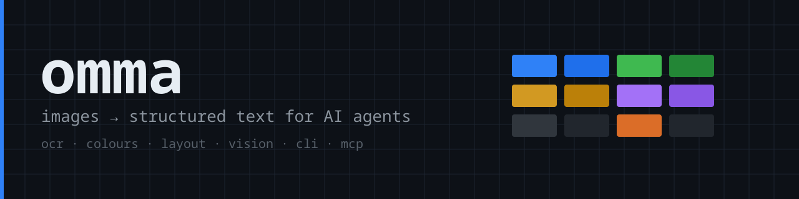

<p align="center">
  
</p>

# omma

*ὄμμα — Greek for "eye".*

**Give a text-only model eyes.** `omma` turns an image into structured text and JSON
an AI agent can reason about: OCR with boxes and confidence, colour palette, a
spatial colour grid, layout regions, and a description from a vision model — local
or hosted. One engine behind a CLI and an MCP server.

<p>
  <a href="https://github.com/Dopethedev/omma/actions/workflows/ci.yml"></a>
  <a href="https://github.com/Dopethedev/omma/releases/latest"></a>
  
  
  <a href="LICENSE-MIT"></a>
</p>

## Thirty seconds

```console
$ cargo install --git https://github.com/Dopethedev/omma --locked   # or a release binary
$ omma doctor                          # what this machine can do
$ omma screenshot.png                  # a human report
$ omma screenshot.png --json           # the same, as data
$ omma screenshot.png --ask "What does the error dialog say?"
```

```console
$ omma tests/fixtures/text.png
== text.png  (png 600x140, 8 KiB, aspect 4.29)
84000 pixels, rgb8

== text (OCR [untrusted], eng, psm 6, conf 90.6)
Omma reads this line

dominant colours (2304 samples)
  #f8f8f8  83.85%
  #e8e8e8   1.65%
  #a0a0a0   1.48%
  ...
average #f3f3f3  brightness 0.95  saturation 0.00

colour grid 64x36 (hex per cell, every 4. cell left → right, top → bottom; JSON carries all 64x36)
#ffffff #ffffff #ffffff #ffffff #ffffff #ffffff #ffffff #ffffff #ffffff #ffffff #ffffff #ffffff #ffffff #ffffff #ffffff #ffffff
#ffffff #595959 #ffffff #ffffff #ffffff #ffffff #ffffff #e8e8e8 #ffffff #9f9f9f #ffffff #9f9f9f #ffffff #ffffff #ffffff #ffffff
```

```
              image ──► decode ──► tesseract (stdin) ──► text + boxes + hierarchy
                          │                                   │
                          ├──► palette + 64×36 grid           ├──► layout regions
                          │                                   │
                          └──► vision endpoint (optional) ────┴──► one JSON report
```

## What it is

An image-perception utility: one shared analysis engine behind a CLI and a
Model Context Protocol (MCP) server. It measures what an image *is* — text,
geometry, colour — and hands back data. It is not a model, a chatbot or an image
generator.

What it extracts:

- **Text**, via Tesseract, with word-level boxes, confidence, lines, paragraphs,
  blocks and reading order. Small crops are upscaled first; two page-segmentation
  passes run and the longer result wins.
- **Image metadata** — format (from the bytes, not the extension), dimensions,
  aspect ratio, colour type, alpha, pixel count, file size, animation.
- **Colour** — a quantized palette with percentages, average RGB, brightness,
  saturation, and a **spatial colour grid** (64×36 hex cells by default) that
  describes structure even when the image contains no text at all.
- **Layout** — text regions from Tesseract's own bounding boxes, each with a
  nine-cell position label, its confidence and reading order. A block must look
  like text (two or more alphanumeric characters, confidence at or above the
  threshold) before it becomes a region, so photographs do not produce dozens of
  one-character "regions". No objects, buttons or icons are ever invented.
- **Vision** — one question sent to an OpenAI-compatible server and answered as
  text: a local one (Ollama's `/v1`, llama.cpp, LM Studio, vLLM) or a hosted one
  (GLM-5.3-Flash through W&B Inference or Z.AI). Descriptions are marked
  `untrusted`, and the image is downscaled to a configured ceiling before upload.

Everything except the vision call works offline, and no image leaves the machine
unless a remote endpoint was configured explicitly.

## Why

Text-only models are fast, cheap, and often the only thing running offline or on
a server. They cannot see. Putting a measurement tool between the image and the
model gives them the parts of an image that survive as text — without sending the
image anywhere, without a GUI, and without replacing the model.

## How it works

```
                     omma IMAGE / --json           omma mcp serve
                            │                            │
                            └───────────┬────────────────┘
                                        │
                                  analysis engine
                    ┌───────────────────┼───────────────────┐
                 colours              OCR                  layout
              (palette, grid)    (tesseract tsv)    (regions + labels)
                                        │
                            optional: local or hosted vision model
                                        │
                                 text or JSON
```

One engine, two front-ends. The library is synchronous; the async runtime exists
only in the MCP adapter.

## Install

Requires Rust 1.89+.

```console
$ cargo build --release --locked
$ install -m 755 target/release/omma ~/.local/bin/omma
```

Or run it from the checkout: `cargo run -- image.png`.

CI builds and tests a release binary on Ubuntu x86_64, macOS arm64, macOS x86_64
and Windows x86_64, and publishes it with a `.sha256` per platform (see
[docs/release-notes-0.2.0.md](docs/release-notes-0.2.0.md)). The Linux binary is
dynamically linked and needs glibc 2.39 or newer; the source build has no such
constraint.

### Optional external tools

| Tool | Needed for | Notes |
|---|---|---|
| `tesseract` 5.x | OCR | Without it, `ocr` is `null` and a warning explains why; everything else still runs. |
| A vision endpoint | `--ask` / `--vision` | Any OpenAI-compatible `/v1/chat/completions` accepting `image_url` data URIs — local (Ollama, llama.cpp, LM Studio) or hosted (GLM-5.3-Flash) with the key in an environment variable. |

Nothing else is required at runtime: decoding, colour analysis and JSON are pure
Rust.

## CLI

Both documented forms are the same analysis:

```console
omma IMAGE                    # human-readable report
omma analyze IMAGE            # explicit subcommand form
```

| Option | Meaning |
|---|---|
| `--json` | JSON output (alias for `--format json`) |
| `--format text\|json` | Output format |
| `--pretty` | Pretty-print JSON |
| `--region X,Y,W,H` | Analyze only this crop, in source-image pixels |
| `--ocr` / `--no-ocr` | Run OCR only / skip OCR |
| `--colors` | Run colour analysis only |
| `--layout` | Run layout analysis only |
| `--language eng,deu` | OCR language(s); repeatable, `,` or `+` separated |
| `--max-colors N` | Dominant colours to report (1–64) |
| `--ask "QUESTION"` | Ask the configured vision model |
| `--vision` | Ask with the default question |
| `--model NAME` | Vision model to use |
| `--output FILE` | Write the result to a file (stdout stays empty) |
| `--config FILE` | Configuration file |
| `omma doctor` | Versions, backends, configuration, limits |
| `omma mcp serve` | MCP server over stdio |

`omma -` reads the image from stdin. JSON mode writes only JSON to stdout; logs
and errors go to stderr.

Exit codes: `0` success (including partial results with warnings) · `1` input,
decoding or filesystem failure · `2` invalid arguments or configuration · `3` a
requested backend failed · `4` output or serialization failure · `5` MCP server
startup failure.

## JSON

The JSON is a primary product: versioned (`schema_version: "1.0"`), stable, and
documented in [docs/json-schema.md](docs/json-schema.md).

```json
{
  "schema_version": "1.0",
  "tool": { "name": "omma", "version": "0.2.0" },
  "image": {
    "filename": "screenshot.png", "format": "png",
    "width": 779, "height": 337, "aspect_ratio": 2.3116,
    "color_type": "rgba8", "has_alpha": true,
    "pixel_count": 262523, "file_size_bytes": 17447,
    "animated": null, "analyzed_width": 779, "analyzed_height": 337
  },
  "region": null,
  "ocr": {
    "available": true, "untrusted": true, "engine": "tesseract",
    "version": "5.5.4", "language": "eng", "psm": 11, "upscaled": null,
    "text": "Are you sure you want to close this window?",
    "confidence": 91.8,
    "words": [{ "text": "Are", "confidence": 92.7,
      "bbox": { "x": 121, "y": 128, "width": 26, "height": 12,
                "normalized": { "x": 0.155327, "y": 0.379822,
                                "width": 0.033376, "height": 0.035608 } },
      "block": 1, "paragraph": 1, "line": 1 }],
    "lines": [], "paragraphs": [], "blocks": [], "duration_ms": 414
  },
  "colors": {
    "dominant": [{ "hex": "#384040", "rgb": [56, 64, 64], "percentage": 90.8 }],
    "average_rgb": [62, 67, 67], "brightness": 0.2595, "saturation": 0.0936,
    "sample": { "method": "bicubic (CatmullRom) downsample …",
                "width": 64, "height": 36, "samples": 2304,
                "transparent_samples": 0, "quantization_bits": 5 }
  },
  "grid": { "width": 64, "height": 36, "quantization_bits": 5,
            "cells": [["#3c4241", "…"]] },
  "layout": { "regions": [], "grid": { "width": 64, "height": 36, "included": true } },
  "vision": null,
  "warnings": [],
  "processing": { "duration_ms": 490, "stages": { "decode": 10, "colors": 64, "ocr": 414, "layout": 0, "vision": 0 } }
}
```

Rules that hold across the schema:

- **Measured vs interpreted.** Bounding boxes, dimensions and colour statistics
  are measurements. A vision description is model-generated prose and sits in its
  own object.
- **Untrusted content is marked.** `ocr.untrusted` and `vision.untrusted` are
  always `true`: image-derived text and model prose are data to analyze, never
  instructions to follow.
- **Absent means absent.** A subsystem that was disabled or could not run is
  `null`, never a fabricated object; `warnings[]` says why. A subsystem that ran
  and found nothing returns empty arrays.
- **Confidence travels with the text.** `ocr.confidence` is the mean word
  confidence, and every block and region carries its own. Below
  `ocr.min_confidence` (40 by default) the report adds an `ocr_low_confidence`
  warning: the text was measured, but it is probably misread texture. Check the
  warning before feeding `text` to a model.

## MCP

`omma mcp serve` speaks MCP over stdio; stdout carries protocol frames only.

Two tools:

- **`analyze_image`** — one image source: `image_path` **or** `image_base64`
  (inline bytes, data URI accepted), plus `mime_type`, `ocr`, `colors`, `layout`,
  `vision`, `ask`, `language`, `max_colors`, `region`. Returns the same JSON,
  both as text content and as structured content.
- **`omma_capabilities`** — backends, formats, limits, schema version.

Generic client configuration:

```json
{
  "mcpServers": {
    "omma": { "command": "omma", "args": ["mcp", "serve"] }
  }
}

An agent that holds the bytes can skip the filesystem entirely:

```json
{ "name": "analyze_image",
  "arguments": { "image_base64": "iVBORw0KGgo…", "ask": "What is this?" } }
```

Inline images go through the same decoder and the same limits as a file, no
temporary file is written, and supplying both sources (or neither) is an error.
Whether a chat client forwards a pasted image to a tool is the client's decision —
see [docs/mcp.md](docs/mcp.md).

Details, including the filesystem restrictions, are in [docs/mcp.md](docs/mcp.md).

## Vision: local or hosted

OMMA speaks one OpenAI-compatible shape, so the same code drives a model on this
machine or a hosted API. Nothing runs until you configure one, and nothing leaves
the machine until you say so.

**Local** — Ollama, llama.cpp's server, LM Studio, vLLM:

```toml
# ~/.config/omma/config.toml
[vision]
enabled = true
endpoint = "http://127.0.0.1:11434/v1/chat/completions"   # Ollama's OpenAI-compatible path
model = "qwen2.5vl:7b"
```

**Hosted** — GLM-5.3-Flash, exercised against W&B Inference:

```toml
[vision]
enabled = true
endpoint = "https://api.inference.wandb.ai/v1/chat/completions"
model = "zai-org/GLM-5.3-Flash"
allow_remote = true             # the explicit yes to sending an image off-machine
api_key_env = "WANDB_API_KEY"   # the key lives in the environment, not in this file
max_tokens = 2500               # reasoning models think before they answer
```

```sh
export WANDB_API_KEY="<your-key>"   # in your shell, or in ~/.config/secrets.env
omma screenshot.png --ask "Describe this screen and what each control does"
```

Z.AI serves the same model directly (`https://api.z.ai/api/paas/v4/chat/completions`,
model `glm-5.3-flash`); only the endpoint, model id and variable name change.

`api_key_env` names an environment variable; the secret never has to be written
into a config file, a command line or a git checkout. `api_key = "..."` still
works for a value you keep in a 0600 file, and `OMMA_VISION_API_KEY` supplies one
directly. The key is sent as a bearer token and appears in no report, log line,
doctor output or error message; `omma doctor` shows only where it came from.

Rules that hold in both modes:

- A non-loopback endpoint is refused unless `vision.allow_remote = true`.
- A remote endpoint must be `https://`; a loopback server may use plain HTTP.
- Redirects are never followed, and URLs with embedded credentials are refused.
- There is no silent fallback: if the configured provider fails, the report keeps
  OCR, colours, grid and layout, adds a warning naming the failure class
  (`vision_unauthorized`, `vision_rate_limited`, `vision_timeout`,
  `vision_failed`), and exits 3 because the requested backend produced nothing.

With a model configured, one call returns everything: description, objects and
their positions, OCR text, palette, grid and layout, each marked untrusted where
it is model- or image-derived.

```sh
omma photo.jpg --ask "What is happening here?" --json     # answer in .vision
omma chart.png --ask "Explain the trend and the visible values."
omma ui.png    --vision                                   # default question
```

Large images are downscaled before upload (`vision.max_image_dimension`, 1280 by
default; `vision.max_request_mb`, 6 MiB) — the analysis still describes the
full-size image, and `vision.sent_width`/`sent_height` report what the model
actually saw. Setup, model choices, hardware guidance and honest limits of what
has been verified: [docs/vision.md](docs/vision.md).

## Configuration

Defaults < configuration file < environment < command line. The file is
`$XDG_CONFIG_HOME/omma/config.toml`, else `~/.config/omma/config.toml`. See
[docs/configuration.md](docs/configuration.md) and
[examples/config.toml](examples/config.toml).

## Performance

Measured on this machine — Intel i5-12400, 15 GiB RAM, Arch Linux, rustc 1.99.1,
`--release` (thin LTO), warm cache — on a 3840×2160 PNG, decoding + metadata +
palette + grid, no OCR and no vision:

| Metric | Target | Measured |
|---|---|---|
| Total wall time, 10 runs | p95 < 2 s | 88.9–105.8 ms (median 90.7 ms) |
| Peak RSS | < 512 MB | 33 MB |

OCR dominates a full run: roughly 0.4–1 s for a screenshot. Photographs are
slower — Tesseract keeps finding "text" in texture — measured 4–39 s at 4K for
twenty real wallpapers. `--no-ocr` skips all of it.

## Limitations

Stated plainly, because they matter more than the feature list:

- **Layout is not computer vision.** Regions are OCR text blocks with position
  labels. There is no object detection, segmentation, button/icon recognition or
  chart understanding, and nothing is guessed for images without text — the
  colour grid is the structural signal there.
- **Colour percentages are estimates** from a 64×36 bicubic sample with 5-bit
  quantization, not physical measurements. The method is recorded in the report.
- **EXIF orientation is not applied.** No EXIF parser is included, so pixels are
  analyzed as stored.
- **Animated images:** the first frame is analyzed. Frame count is detected for
  GIF only; there is no frame selection.
- **OCR on photographs is not trustworthy.** Tesseract happily reads texture as
  glyphs: a 4K wallpaper produced 5,978 characters at mean confidence 21. OMMA
  reports that text *and* flags it (`ocr_low_confidence`, `ocr.confidence`), and
  refuses to promote such blocks to layout regions — but it does not delete the
  measurement. Decide with the confidence, not with the character count. The same
  noise makes a full run slow on photographs (tens of seconds at 4K); screenshots
  are ~0.4 s.
- **Dense screens produce coarse regions.** A full desktop is one browser/page
  block to Tesseract, so `layout.regions` can be a single large region. Sparse
  text on a plain background segments well; a busy UI does not.
- **Vision output quality is the model's**, not OMMA's. It has been exercised end
  to end with GLM-5.3-Flash on four image types (chart, diagram, desktop
  screenshot, 4K artwork) — see [docs/vision.md](docs/vision.md) for what was run
  and what was not. No local model was installed on the development machine, so
  the local path is verified against a mock server.
- **OCR languages** beyond `eng` require Tesseract language packs; the installed
  set is reported by `omma doctor` and missing ones produce warnings.
- **Colour sampling resizes straight (non-premultiplied) alpha.** A hard edge
  between an opaque colour and fully transparent pixels can darken the few grid
  cells that straddle it, because the transparent side's RGB is averaged in. Fixing
  it would change every palette and grid value, so it is documented rather than
  silently changed.
- Not implemented: PDF pages, video frames, batch/multi-image runs, QR/barcodes,
  table or chart detection, image comparison, extra OCR or vision providers.
- **Platforms**: Ubuntu x86_64, macOS arm64 and Windows x86_64 are tested
  natively on every push. Linux aarch64, macOS x86_64, Windows ARM and the BSDs
  are untested and unclaimed.

## Security

See [docs/mcp.md](docs/mcp.md) for the MCP boundary and
[docs/json-schema.md](docs/json-schema.md) for the untrusted-content contract.

- File format is decided by content, never by extension; decoding runs under the
  `image` crate's own limits (bytes, dimensions, allocation).
- SVG and other XML markup is refused rather than interpreted.
- Tesseract is spawned with explicit arguments — no shell — with a timeout, its
  output captured, and the image fed over stdin so no temporary file is written.
- OCR text, image contents and API keys are never logged.
- Text mode strips control characters from image-derived strings (file names, OCR
  text, model answers), so they cannot drive the terminal with escape sequences.
- MCP paths are canonicalized and can be restricted to allowed directories;
  symlinks are resolved before the check, so a link cannot escape a root.

## Development

```console
$ cargo fmt --all -- --check
$ cargo test
$ cargo clippy --all-targets --all-features -- -D warnings
```

Tests use small generated fixtures in `tests/fixtures/`; OCR tests skip loudly
when Tesseract is absent, and the vision tests use a local mock server.

`.github/workflows/ci.yml` runs the same checks natively on Ubuntu, macOS and
Windows — formatting, Clippy, the full suite, a release build, and smoke tests of
that release binary including a complete MCP exchange — plus an MSRV job that
builds on the declared minimum Rust. `ci/*.mjs` are the Node helpers those smoke
tests use; they are CI-only and not part of the crate.

Before a release, work through [docs/release.md](docs/release.md).

## Licence

MIT OR Apache-2.0.
